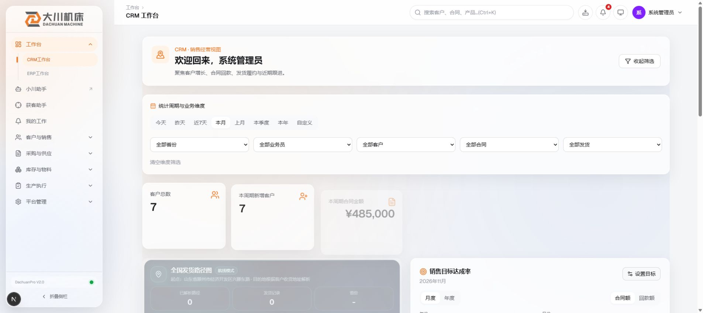

> 历史停测记录。D1 归因已更正：这是本功能分支新增缺陷，非正式环境原有问题；以下历史表述不得作为当前结论。见 d1-mysql-admitted.md。

# V2：测试库完整流程停测报告

状态：**未通过**。在 V2-a 发现实际缺陷后，按“只记录、不修复、停下来汇报”的指令停止。V2-b 未启动、未构建，不能引用此前 Linux CI 代替本轮正式模式验收。

## 实测环境与证据边界

使用 V1 的 C 库。通过环境变量执行原 seed，创建超管 1、区域销售 3、外贸 1，另有 seed 测试客户 8、合同 3。密码随机生成，未输出；无 worktree 内运行时环境文件，上传目录在仓库外。开发服务 NODE_ENV=development、LEAD_TYC_MOCK=1、LEAD_HUNTER_FAKE_SEARCH=1。

模型为仓库外启动、仅监听 127.0.0.1 的 HTTP 模拟服务，返回固定测试关键词和评分；搜索使用现有 fake search，天眼查没有调用。子进程网络保护阻止外部业务请求，仅允许回环及 Google 字体静态资源；被拒绝的辅助元数据请求见证据，不是已发出的供应商调用。

接口使用实际账号登录及 HTTP 会话。没有把接口测试写成页面验收。Chrome 实际完成超管登录并显示 CRM 工作台，已保存不含密码的截图；其他页面项没有完成。

## V2-a 逐项结果

| 项目 | 结果 | 实际证据/未完成原因 |
| --- | --- | --- |
| seed 创建账号与基础数据 | 通过 | 原脚本 exit 0；5 账号、8 客户、3 合同 |
| 超管、区域销售、外贸 API 登录 | 通过 | 三种角色会话返回正确 |
| 超管浏览器登录及工作台 | 通过 | 实际 Chrome 页面及截图；不是其余业务页验收 |
| 模拟开关及额度读取 | 通过 | quota 接口 used=0、fakeSearchMode=true、tycMockMode=true |
| 创建并完成获客任务 | 通过 | HTTP 200，任务 done，3 个候选，score=90 |
| 候选电话/证据 SELECT | 通过 | 两个 PAGE_TEXT 号码的 excerpt 含对应公司全称和号码；无电话候选 NO_CONTACT、phone/source/evidence 均 NULL |
| 任务 report.admitted 数值类型 | 未通过 | 实际 JSON STRING，长度 255；真实入池数为 0，详见下节 |
| 84 分拦截、85 分无电话入池及不分配 | 未通过 | 停测前未执行，不能记为已通过 |
| 名录误配、紧凑名录、版权所有页脚、传　真、传真（Fax）、传真 A/B、R7 换后缀 | 未通过 | 停测前未执行本轮接口或页面验收，不能沿用单元测试冒充实测 |
| 无名称采用 409、仅驳回、模拟/停业结果不可采用、并发确认 | 未通过 | 停测前未执行 |
| 反查、邮箱不足、不同企业待确认、缓存、额度耗尽/重启、共用号码/客户去重 | 未通过 | 停测前未执行；其中真实计费仍须未来 V3 |
| 销售/外贸仅查看自己的线索及无管理入口 | 待用户页面验收 | 仅完成角色 API 登录，未完成此权限流程或页面检查 |
| 登录以外的客户、报价、合同、回款、发货、上传、区域权限、小川只读冒烟 | 待用户页面验收 | 工作台能显示不代表这些页面已逐项验收 |

表中“未通过（未执行）”表示本轮验收条件尚未满足，不代表断言已经执行失败。

## 已确认缺陷（不修复）

- 位置：`src/lib/lead-hunter/engine.ts:92`，任务心跳中的 JSON_SET / COALESCE(JSON_EXTRACT(report, '$.admitted'), 0) 表达式。
- 触发：在 MySQL 5.7.44 上，通过真实任务 API 创建 1 轮、3 个结果的模拟任务；任务完成前没有执行任何入池请求。
- 预期：report.admitted 为 JSON 数值 0。
- 实际：任务详情 HTTP 返回反复转义的字符串；SELECT JSON_TYPE 得到 STRING，JSON_UNQUOTE 后长度 255；任务 status=done、totalCandidates=3、数据库 ADMITTED 候选数=0。
- 该表达式在原基线 3c50d5bd 中也存在，属于基线已有风险，不将其归因于 F1–F3/R1–R8。本轮只确认现象和代码位置；SQL 返回类型/隐式转换与反复写回有关的根因仍需单独排查。
- 未修改源码或测试，未放宽断言、未重置数据重试此流程。

[HTTP 请求/响应](evidence/v2-http.jsonl)、[数据库 SELECT](evidence/v2-defect-db-select.txt)、[缺陷汇总](evidence/v2-defect-summary.json)。SELECT 同时确认：leads=0、lookups=0、quota 行=0/used=0、operation_logs=0。本轮尚未执行入池、反查或确认，不能把这些 0 当作 V2-b 无副作用验收。

## V2-b 逐项状态

| 项目 | 结果 | 实测范围 |
| --- | --- | --- |
| production 且 token 为空启动 | 未通过 | 因 V2-a 缺陷停止，未执行 build / production start |
| 管理页“天眼查未配置” | 待用户页面验收 | 未执行 |
| 单条及批量反查 503、提示清楚 | 未通过 | 未执行 |
| contactStatus/phone/assignedUserId 不变，额度不增加，无计费记录 | 未通过 | 未执行正式模式前后 SELECT，不得据模拟模式推断 |
| 无名称待确认结果只能驳回 | 未通过 | 未执行 |
| 销售看不到反查入口 | 待用户页面验收 | 未执行 |
| 登录、客户、报价、合同冒烟 | 待用户页面验收 | production 模式未执行 |

## 页面后续清单（实际结果留空）

原开发地址为 http://127.0.0.1:53112，现服务和容器均已删除，不能直接打开继续验收。待缺陷单独处理并重建本地测试环境后，以新的本机地址替换下列 BASE。账号仅为 seed 合成的测试角色，不在文档保存密码。

| 地址/角色 | 操作步骤 | 预期 | 实际结果 |
| --- | --- | --- | --- |
| BASE/lead-hunter，超管 | 创建任务，观察完成后的报告与候选 | 计数为数值且准确；候选原文证据正确 | |
| BASE/leads，超管 | 按部署文档第 5 节和整改报告第 6 节逐项检查 | 无名称不可采用；传真/名录不误配；模拟不可采用 | |
| BASE/leads，区域销售/外贸 | 查看线索及导航、尝试管理接口 | 仅有权限数据，无反查/确认入口，接口拒绝越权 | |
| BASE/leads，production 超管 | 触发单条和批量反查 | 未配置提示、503，无电话/状态/额度副作用 | |
| BASE/customers、BASE/contracts 等，三种角色 | 查看客户/报价/合同及其他冒烟页面 | 页面可用且权限正确 | |

V3 因未充值暂缓；V4 SQL 和本地语法试跑均未继续。停止后的数据库和私有临时文件已清理，见清理记录。本轮材料保持未提交，未触发新的 PR checks。
